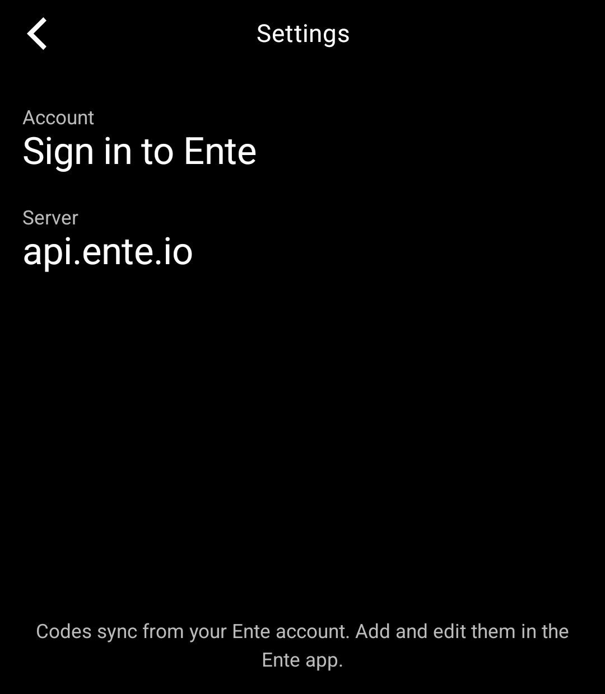
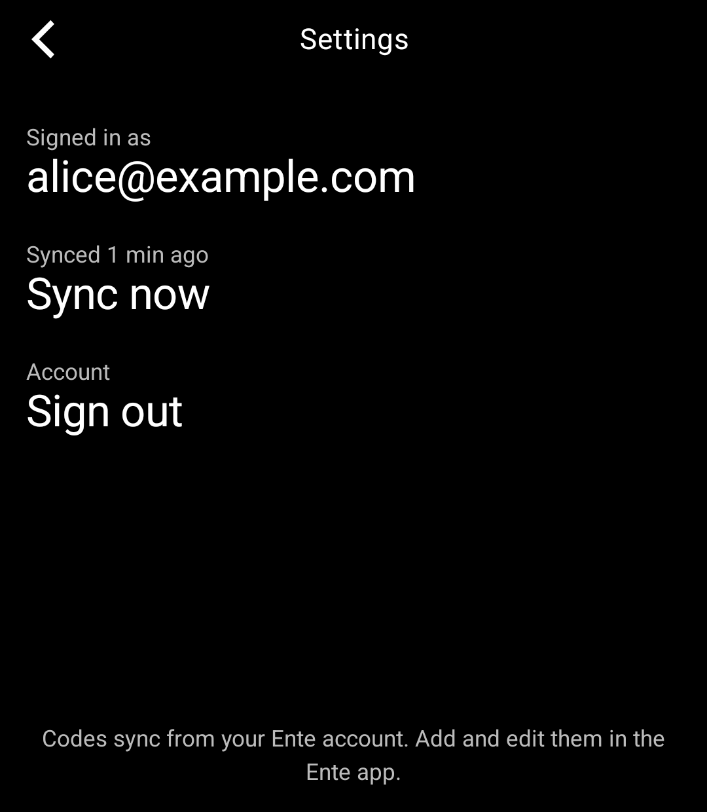

# Ente Auth for the Light Phone III

An unofficial two-factor code tool for the Light Phone III for [Ente Auth](https://ente.io/auth) accounts, built
with the [Light SDK](https://github.com/lightphone/light-sdk).

- Sign in to your Ente account, on Ente's servers or your own self-hosted Ente
- See your two-factor (TOTP) codes with a countdown
- Codes stay in sync with your account, one way, from Ente to the phone

  
  
  
  

The screenshots use a made-up test account.

## Signing in

Open **Settings → Sign in to Ente** and enter your Ente email and password. If your account has two-factor
login, enter the code from your authenticator app or the one Ente emails you. Accounts that use a passkey for
two-factor login can't sign in, as the Light Phone can't use passkeys.

The tool uses Ente's own servers (`api.ente.io`) by default. If you run your own Ente server, change
**Settings → Server** to its address before signing in; plain `http://` works for servers on your home network.

Your codes then sync from Ente to the phone. Add, edit and delete codes in the Ente app on your other devices;
the changes show up on the phone. Nothing on the phone is sent back. Signing out removes the codes from the phone;
they stay in your Ente account.

Ente's end-to-end encryption is unlocked on the phone, and your Ente password never leaves it. Codes are stored
on the phone encrypted with a key kept in the Android Keystore.

Supported: TOTP codes with SHA-1, SHA-256 or SHA-512. HOTP (counter-based) and Steam codes in your account are
skipped.

This project is not affiliated with Ente.

## Install

You need JDK 21, the Android SDK and `adb`, and a Light Phone III you can sideload tools onto over ADB.

1. Build: `./gradlew :tool:assembleDebug`
2. Install: `adb install -r tool/build/outputs/apk/debug/tool-debug.apk`

To run it in the LightOS emulator instead, switch `serverPackage` in `tool/lighttool.toml` to
`"com.thelightphone.sdk.emulator"` and build with `./gradlew :tool:assembleDebug -DlightSdk.allowAltServerPackage=true`.

The tool's code is in [`tool/`](../tool). Everything else in this repository is the Light SDK (MIT licence); the
SDK's own README is [`README.md`](../README.md).
