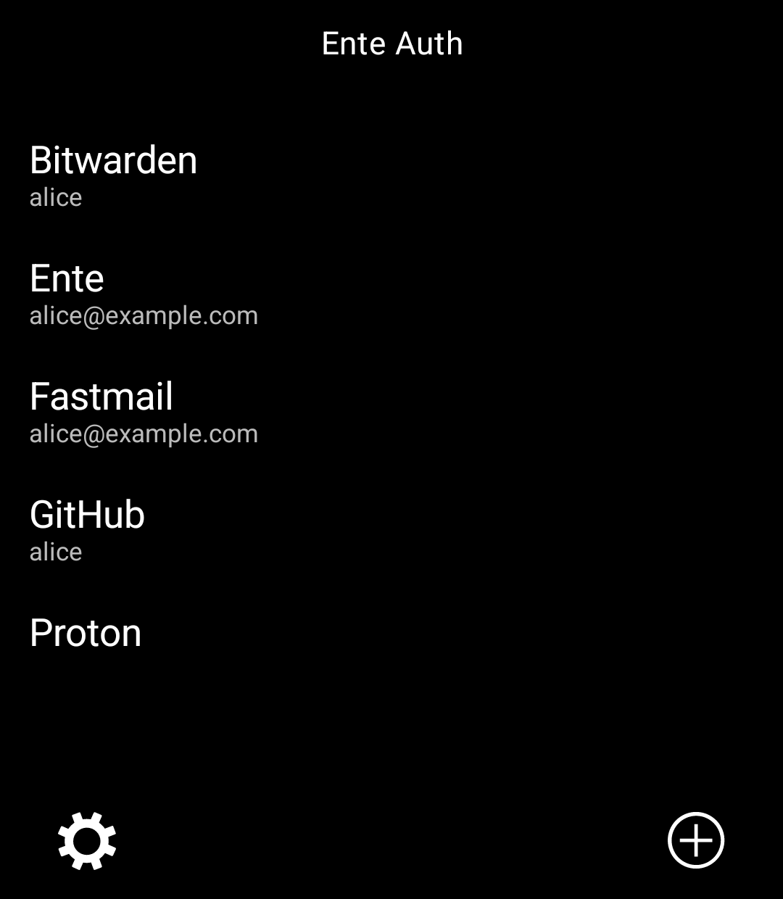
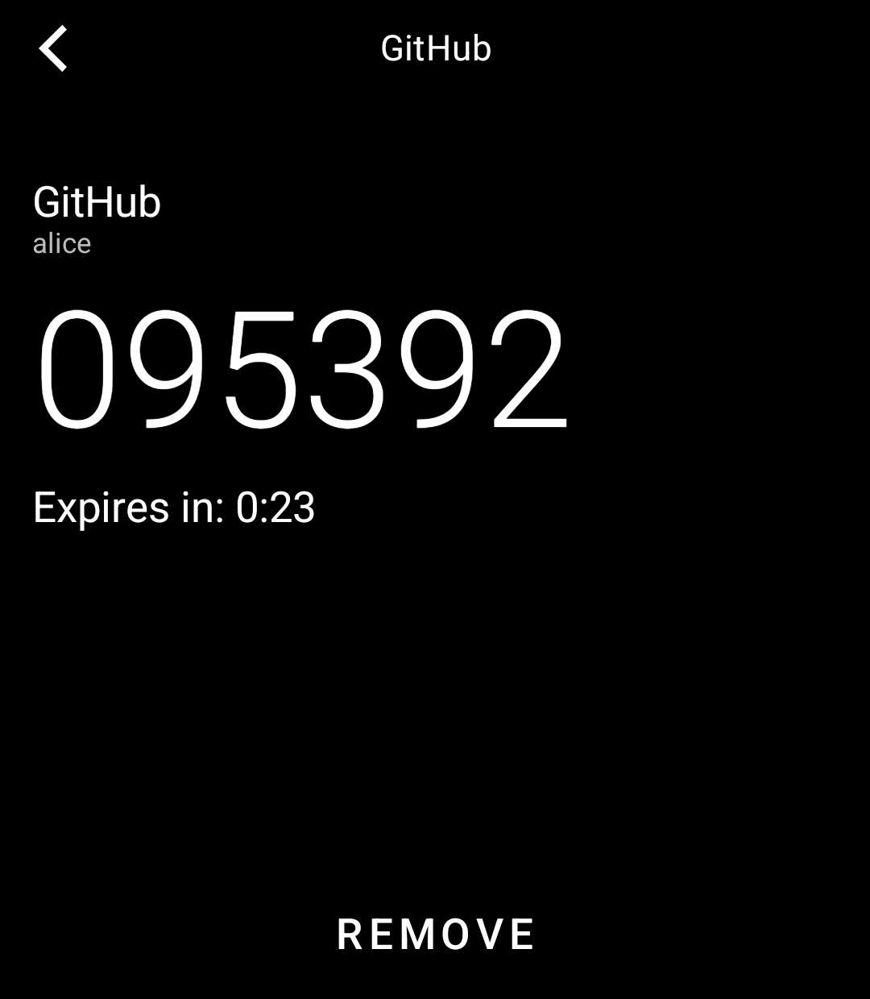
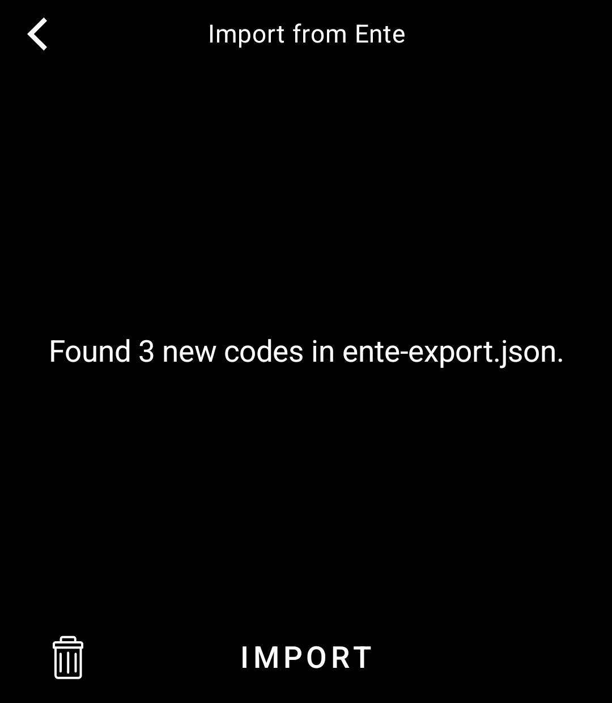
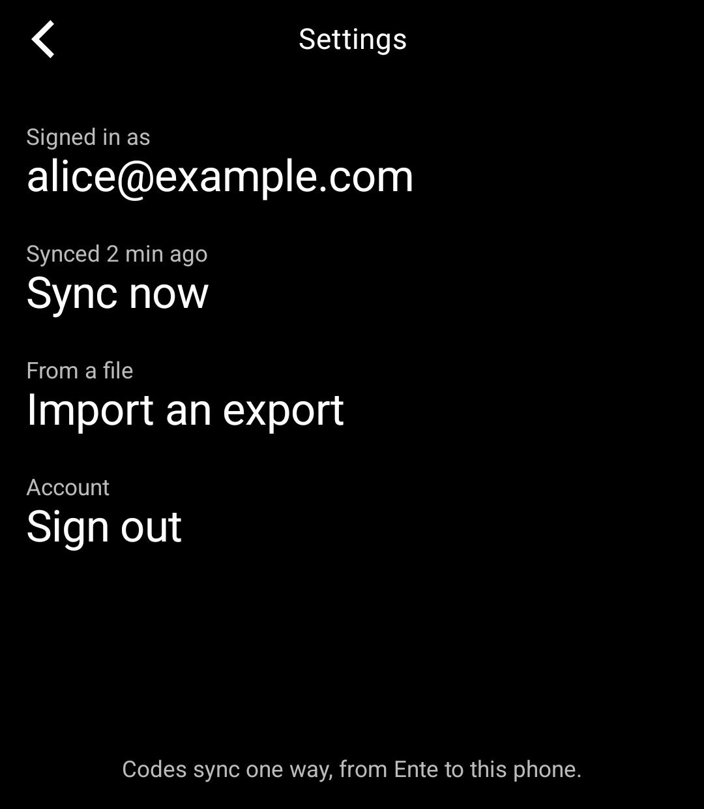

# Ente Auth for the Light Phone III

An unofficial two-factor code tool for the Light Phone III that works with [Ente Auth](https://ente.io/auth),
built with the [Light SDK](https://github.com/lightphone/light-sdk).

- See your two-factor (TOTP) codes with a countdown
- Sign in to your Ente account and keep codes in sync, one way, from Ente to the phone
- Or import an Ente Auth export file, plain or encrypted, from your computer
- Add single codes by scanning their QR code

  
  
  
  

The screenshots use a made-up test account.

## Getting your codes onto the phone

**Sign in to Ente** (Settings → Sign in to Ente): enter your Ente email and password. If your account has
two-factor login, enter the code from your authenticator app or the one Ente emails you. Codes then sync from Ente
to the phone; nothing on the phone is sent back. Accounts that use a passkey for two-factor login can't sign in, as
the Light Phone can't use passkeys. Self-hosted Ente servers work too: change Settings → Server.

**Import an export**:

1. In the Ente Auth app on your other device, open Settings → Data → Export codes.
2. On a computer on the same Wi-Fi as your Light Phone, open the Tool Manager from the phone's Settings.
3. Choose Ente Auth → Ente export and upload the file.
4. Open Ente Auth on the phone; the import starts on its own. Encrypted exports ask for their password. The file is
   deleted from the phone once it's imported.

Codes are stored encrypted with a key kept in the phone's Android Keystore. Ente's end-to-end encryption is
unlocked on the phone; your Ente password never leaves it.

Supported: TOTP codes with SHA-1, SHA-256 or SHA-512. HOTP (counter-based) and Steam codes are skipped on import.

This project is not affiliated with Ente.

## Install

You need JDK 21, the Android SDK and `adb`, and a Light Phone III you can sideload tools onto over ADB.

1. Build: `./gradlew :tool:assembleDebug`
2. Install: `adb install -r tool/build/outputs/apk/debug/tool-debug.apk`

To run it in the LightOS emulator instead, switch `serverPackage` in `tool/lighttool.toml` to
`"com.thelightphone.sdk.emulator"` and build with `./gradlew :tool:assembleDebug -DlightSdk.allowAltServerPackage=true`.

The tool's code is in [`tool/`](../tool). Everything else in this repository is the Light SDK (MIT licence); the
SDK's own README is [`README.md`](../README.md).
